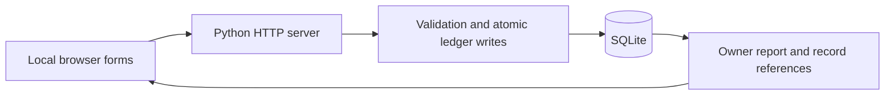

# BrickFlow

**Stage 2 · Finished portfolio sample**

A local brick-manufacturing operations demo built with Python, SQLite and JavaScript.

BrickFlow connects production, stock, work credits, bills, sales and payments so a reviewer can follow a reported balance back to its records. It is an AI-assisted learning and portfolio project by Satyam Tomar, informed by brick-industry workflow research in India.

Stage 1 defined the workflow and records. Stage 2 is the runnable sample, ready for human review using the [five-minute walkthrough](docs/DEMO.md). All included identities, quantities and transactions are fictional.

A real-plant pilot is a later milestone. It needs complete operating-cost records, reconciliation against permissioned source records, and authenticated roles. The sample does not establish production ERP readiness, SAP integration or measured business savings.

## What you can try

| Workflow | Implemented controls |
| --- | --- |
| Production and stock | Linked moulding/work records, stage transfers, grading, dispatch and return inspection |
| Work and supplier bills | Separate approval and payment; correction requests retain review history |
| Customer money | Receipts, sale allocations and separate customer advances |
| Opening balances | Named cash/bank accounts; unknown stays distinct from confirmed zero |
| Reconciliation | Opening debt settlement stays separate from current activity; payment checks use the selected account |
| Owner reporting | Stock and money summaries, attention flags and supporting record references |
| Data integrity | Integer paise, atomic transactions, duplicate-request safeguards, verified backups and copy-only schema upgrades |

The plant map and planning comparisons are illustrative teaching tools, not a measured layout or validated forecast.

## Run locally

Requirements: **Python 3.13** with SQLite 3.37 or newer. Runtime uses the Python standard library; no Python packages, account, API key or cloud service is needed to launch the app. Node.js is only needed for JavaScript tests.

Download this repository using GitHub's **Code → Download ZIP** and extract it, or clone it with Git. In a terminal, change into the extracted repository folder and run:

```sh
python development/review_app/server.py --port 8770
```

On systems where Python is named `python3`, substitute that command. Open **http://127.0.0.1:8770/**. Stop with **Ctrl+C**. The app listens only on this computer. Restarting uses the same saved fictional database; it does not reset your entries.

On Windows, `development/review_app/start.ps1` is an optional launcher. A repository-local `.venv` is used when available, otherwise it uses `python` on PATH.

**Start here:** [the five-minute demo](docs/DEMO.md). The untouched seeded example shows **500 bricks and INR 3,500 cash**. These are test figures, not profit or real plant balances.

### Try blank financial openings

```sh
python development/review_app/server.py --reviewed --db development/review_app/data/opening-review.sqlite3 --port 8771
```

Open http://127.0.0.1:8771/. This requires a **new** database filename. Register cash/bank accounts in Money setup, review their openings, then lock setup before recording current activity. The parties, period and stock template remain fictional. To reopen this workspace, use the same command without `--reviewed`.

## Verify the sample

Create an optional local test environment and install the pinned development tools:

```sh
python -m venv .venv
# Windows PowerShell:
.venv/Scripts/python.exe -m pip install -r requirements-dev.txt
# macOS/Linux: use .venv/bin/python instead.
```

Run these commands with that environment's Python:

```sh
python -B -m pytest -q -p no:cacheprovider development/review_app development/chapter3/test_ledger.py development/chapter3/test_accounts.py development/chapter6/test_owner_report.py development/plant_map/test_process_wait.py prototype/test_planning_engine.py
node --test development/review_app/test_app.js
python -B -m ruff check development/review_app development/chapter3/ledger.py development/chapter3/upgrade.py development/chapter3/accounts.py development/chapter3/test_accounts.py development/chapter6/owner_report.py prototype/planning_engine.py
```

For example, replace `python` with `.venv/Scripts/python.exe` on Windows. [Verification scope and results](docs/VERIFICATION.md) distinguish automated checks from real-world validation.

## How it fits together



| Folder | Purpose |
| --- | --- |
| `development/review_app` | Browser interface, local HTTP server and integration tests |
| `development/chapter3` | Ledger, accounts, schemas, migrations and ledger tests |
| `development/chapter6` | Owner report and report tests |
| `development/plant_map` | Illustrative process timing examples |
| `learning` | Two fictional fixtures used by the demo |
| `prototype` | Separate fictional what-if planning engine |

The chapter names retain the project's learning history. The sample contains only the dependencies needed for these workflows.

## Data and limitations

Generated SQLite files and backups stay local and are excluded by an explicit Git allowlist. Private source documents, photographs, transcriptions, business questionnaires and local development history are not included. Do not add real business records to this sample.

Demo owner/accountant roles are **not authenticated**. Do not expose the server to the internet or use it for operational accounting. Full operating costs, profit/tax reporting, transfers, overdrafts, refunds, opening corrections and multi-plant operation are outside the sample. Recorded cash is not profit. Real use would require confirmed records, complete cost scope, reconciliation, access control and an operator trial.

Older supported databases can be upgraded to a **new copy** with `development/chapter3/upgrade.py`; opening a file never silently upgrades it. Stop the app first and preserve the original. See [the demo guide](docs/DEMO.md#backups-and-upgrades).
